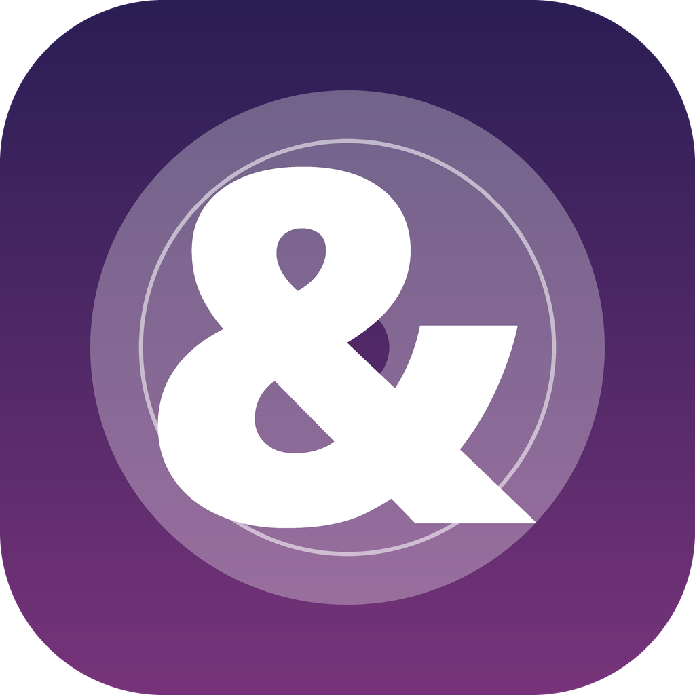

# Amp

**Version: 0.1.0-beta** · An early beta. Expect rough edges and breaking changes.

A native **iOS 26 / iPadOS 26** music client for your Plex library, built with SwiftUI and
Apple's native **Liquid Glass** design language. Universal: iPhone and iPad.



> Amp is an independent client that talks to your own Plex Media Server through the
> official Plex API. It is not affiliated with or derived from Plexamp or Plex, Inc.

## Status (0.1.0 beta)

- [x] Plex PIN/OAuth sign-in (`plex.tv/link`)
- [x] Library browse: artists → albums → tracks
- [x] Playback via `AVAudioPlayer`, queue, next/previous, repeat/shuffle
- [x] Liquid Glass chrome: `.glassEffect`, `GlassEffectContainer`, `.buttonStyle(.glass)`
- [x] Universal layouts (iPhone stack, iPad split view)
- [ ] Search, offline downloads, gapless, scrobbling (planned)

## Requirements

| Tool | Version |
| --- | --- |
| Xcode | 26.0+ |
| iOS SDK | 26.0+ |
| Swift | 6.0 |
| iOS / iPadOS | 26.0+ |

Liquid Glass requires iOS 26. There is no fallback for older OS versions in this beta.

## Build

This project is generated with [XcodeGen](https://github.com/yonaskolb/XcodeGen):

```sh
brew install xcodegen
xcodegen generate
open Amp.xcodeproj
```

Then set your signing team in Xcode and run on an iOS 26 device or simulator.

## Screenshots
Screenshots are produced by your Mac (this repo's CI/dev machine is Linux and cannot run
the simulator). See [`Screenshots/README.md`](Screenshots/README.md) and the
`fastlane` `screenshots` lane:

```sh
bundle install
bundle exec fastlane screenshots
```

## App icon

The icon is an original, **layered Liquid Glass** design authored as an iOS 26
[Icon Composer](https://developer.apple.com/icon-composer/) package at
[`Amp/Resources/AppIcon.icon/`](Amp/Resources/AppIcon.icon) — a glass "record" disc
behind a crisp white ampersand, over a subtle indigo→violet gradient. Icon Composer
supplies the material (refraction, specular, translucency, shadow); the layer assets
are flat with hard edges.

Regenerate reproducibly (writes both the `.icon` package and the legacy flattened
asset-catalog PNG for pre-iOS 26):

```sh
python3 tools/make_icon.py
```

Validate/render on a Mac with `ictool` (bundled inside `Icon Composer.app`) or by
opening the package in Icon Composer. The flattened fallback lives at
`Amp/Resources/Assets.xcassets/AppIcon.appiconset/AppIcon-1024.png`.

## Versioning

Everything is pre-1.0 during beta. `MARKETING_VERSION` starts at `0.1.0` and increments
in the `0.x` range until the app is stable enough for `1.0`.

## License

MIT (see `LICENSE`). Not affiliated with Plex, Inc.
